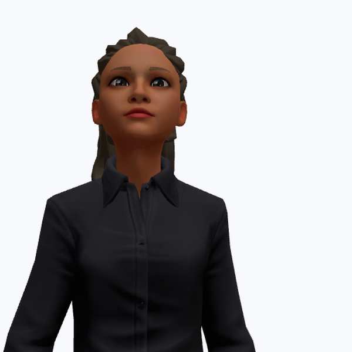

# Speaking Avatar



A 3D talking avatar that runs in any page as a web component. The browser renders the character; a
small Python backend streams the reply from an LLM and speaks it sentence by sentence; the model's
visemes drive the lip-sync.

Status: a prototype, built in May 2026 and published on npm as `speaking-avatar`. It is not under
active development, so issues may go unanswered. It exists because of the Moodle block in this
repository: the goal was a lip-synced tutor inside a course page, and both halves are here.

## What works

- `<speaking-avatar>`, a custom element that mounts a Three.js scene with one of four rigged avatars.
  The models carry ARKit viseme morph targets, so the mouth follows the audio instead of a loop.
- A FastAPI backend with `/health`, `/chat`, `/chat/stream` (SSE), `/tts` and `/stt`.
- Streaming: tokens reach the page immediately, a `SentenceBuffer` cuts the text at `. ! ?` (forced
  at 80 characters, 800 ms timeout), and each sentence goes to Edge TTS concurrently. Audio events
  carry a `seq`, so the client can reorder them before playback.
- Four LLM backends: OpenRouter, any OpenAI-compatible endpoint, Anthropic, and Ollama. Speech to
  text runs on faster-whisper, or on a mock engine when no model is downloaded.
- Docker Compose for the full stack, and a Moodle block that embeds the component in a course.

## Install

```bash
npm install speaking-avatar
```

```html
<script src="https://cdn.jsdelivr.net/npm/speaking-avatar/dist/speaking-avatar.umd.js"></script>
<speaking-avatar></speaking-avatar>
```

```js
const avatar = document.querySelector('speaking-avatar');
avatar.speak('Hello!');           // text to speech
avatar.ask('What is gravity?');   // LLM reply, spoken progressively
avatar.listen(audioBlob);         // speech to text
avatar.configure({ avatar: 'The Scholar' });
```

Give the element a height, or a parent that does. Without one it falls back to 320 px.

## Run the full stack

```bash
git clone https://github.com/marcello-russo/speaking-avatar
cd speaking-avatar
cp backend/.env.example backend/.env   # add one LLM provider key
docker compose up -d
```

The demo page is at http://localhost:5173, the API at http://localhost:8000.

## Attributes

| Attribute | Default | Description |
|---|---|---|
| `tts-api` | `http://localhost:8000/api/v1` | TTS endpoint |
| `stt-api` | `http://localhost:8000/api/v1/stt` | STT endpoint |
| `llm-api` | `http://localhost:8000/api/v1/chat/stream` | Streaming chat endpoint |
| `voice` | `it-IT-ElsaNeural` | Edge TTS voice |
| `avatar` | `The Coach` | `The Coach`, `The Scholar`, `The Mentor`, `The Innovator` |
| `context` | empty | Course or lesson context passed to the LLM |
| `min-height` | `320px` | Height used when the page does not constrain the element |

### Methods

| Method | Returns | Description |
|---|---|---|
| `speak(text)` | `Promise<void>` | Speak the text through the TTS endpoint |
| `ask(message)` | `Promise<string>` | Stream a reply, speak it as it arrives, return the full text |
| `listen(audio)` | `Promise<string>` | Transcribe an audio blob |
| `configure(opts)` | `void` | Change attributes at runtime |

### Events

| Event | Detail | Fired when |
|---|---|---|
| `speechstart` | `{ text }` | Playback of a sentence starts |
| `speechend` | `{ text }` | Playback of a sentence ends |
| `viseme` | `{ viseme, time }` | The mouth moves to a viseme |
| `error` | `{ error, source }` | The LLM, TTS or STT call fails |

## API

| Route | Method | Description |
|---|---|---|
| `/api/v1/health` | GET | Health check |
| `/api/v1/chat` | POST | Whole reply in one response |
| `/api/v1/chat/stream` | POST | SSE: `token`, `audio_complete`, `done` |
| `/api/v1/tts` | POST | MP3 for a given text |
| `/api/v1/stt` | POST | Transcript for an uploaded clip |

The SSE stream carries text and audio on the same connection:

```
event: token           {"type":"token","text":"Ciao"}
event: audio_complete  {"type":"audio_complete","seq":0,"data":"<base64 mp3>","dur":1.2}
event: done            {"type":"done","session_id":"..."}
```

## Configuration

| Variable | Default | Description |
|---|---|---|
| `LLM_PROVIDER` | `openrouter` | `openrouter`, `openai`, `anthropic` or `ollama` |
| `OPENROUTER_API_KEY` | — | OpenRouter key |
| `OPENROUTER_MODEL` | `openai/gpt-4o-mini` | Model name |
| `OPENAI_API_KEY` | — | Any OpenAI-compatible key |
| `OPENAI_BASE_URL` | `https://api.openai.com/v1` | Custom endpoint (vLLM, Groq, Together) |
| `OPENAI_MODEL` | `gpt-4o-mini` | Model name |
| `ANTHROPIC_API_KEY` | — | Anthropic key |
| `ANTHROPIC_BASE_URL` | `https://api.anthropic.com` | Custom Anthropic-compatible endpoint |
| `ANTHROPIC_MODEL` | `claude-sonnet-4-20250514` | Model name |
| `OLLAMA_BASE_URL` | `http://localhost:11434` | Local Ollama |
| `OLLAMA_MODEL` | `llama3` | Model name |
| `TTS_VOICE` | `it-IT-ElsaNeural` | Edge TTS voice |
| `STT_ENGINE` | `mock` | `whisper` or `mock` |

## How the stream is assembled

```
SSE stream ──► /chat/stream ──► LLM provider
                   │
            ┌──────┴──────┐
      event "token"   SentenceBuffer ──► TTS pipeline
      (text,           (word-aware        (Edge TTS,
       immediate)       boundary,         concurrent,
                        80 chars,         seq-numbered)
                        800 ms)
                              │
                        event "audio_complete"
                        (base64 MP3 + seq + dur)
```

Text and audio are independent: the first token reaches the page while the model is still writing,
and audio for sentence one plays while sentence two is being synthesised.

## Development

```bash
# backend
cd backend
python -m venv .venv && . .venv/bin/activate
pip install pytest pytest-asyncio
python -m pytest tests -q

# web component
cd web-component
npm ci
npm run dev      # demo page on :5173
npm run build    # dist/speaking-avatar.{es,umd}.js
```

CI runs both on every push. Editing `web-component/package.json` on `main` publishes to npm.

## Known limits

- The frontend still uses Svelte 4 syntax (`export let`), so the build prints migration warnings on
  Svelte 5. It compiles and runs.
- The faster-whisper models are downloaded on first use; `STT_ENGINE=mock` keeps the container small.
- The four avatars are the only tested models. Custom GLBs need an ARKit-compatible viseme set.
- No tests cover the frontend; the backend has tests for the audio cache and the sentence buffer.

## License

MIT, see [LICENSE](LICENSE).
